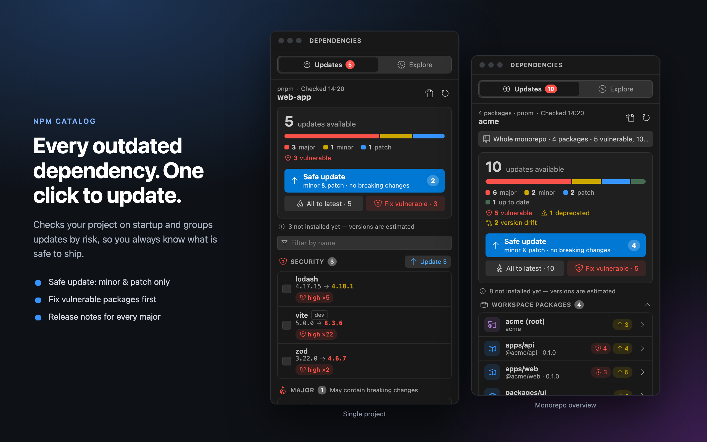
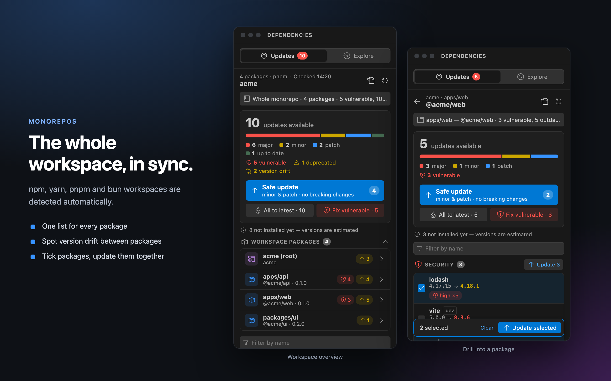
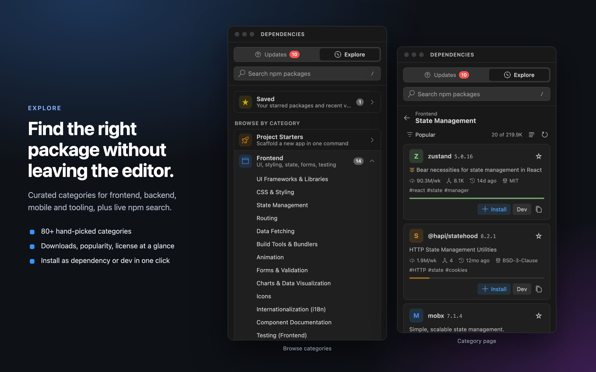
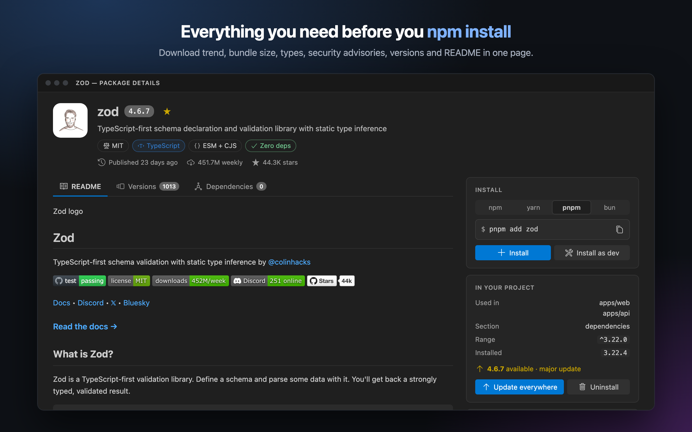

# NPM Catalog — dependency updates for VS Code

See every outdated, vulnerable and deprecated npm package in your project or
monorepo, and update them in one click — without leaving the editor.



## Why

- **You open VS Code and already know.** Dependencies are checked on startup;
  the number of available updates appears on the activity bar icon and in the
  status bar.
- **Safe by default.** *Safe update* installs only minor and patch versions, so
  nothing breaking slips in. Major versions are one click away, with a
  confirmation and release notes.
- **Security first.** Packages with known advisories are listed at the top and
  *Fix vulnerable* updates only them.

## Features

### One-click updates

| Button | What it does |
| --- | --- |
| **Safe update** | Minor and patch versions only — keeps every major version |
| **All to latest** | Everything to the newest version, asks before major updates |
| **Fix vulnerable** | Only packages with known security advisories |
| **Update selected** | Tick any packages in the list and update just those |

Dependencies are grouped by risk — **Security**, **Deprecated**, **Major**,
**Minor**, **Patch**, **Up to date** — and every group can be updated on its
own. Major updates link straight to the release notes.

### Monorepos



npm, yarn and bun `workspaces`, `pnpm-workspace.yaml` and `lerna.json` are
detected automatically.

- **Whole monorepo** view merges the dependencies of every package and shows
  where each one is used.
- **Version drift**: see when the same dependency is on different versions in
  different packages.
- Updating from the overview changes every package at once, so versions stay
  in sync. Open any package to work with it alone.

### Explore



A secondary tab for discovering packages: 80+ curated categories for
frontend, backend, mobile and tooling, live npm search with autocomplete,
saved packages and recently viewed. Each card shows weekly downloads,
dependents, last publish, license and popularity compared with the rest of
the list.

### Package details



Download trend for the last year, bundle size, TypeScript support, module
format, security advisories, GitHub activity, versions, dependencies and the
README. Install with npm, yarn, pnpm or bun, any exact version, as a
dependency or dev dependency.

## How updates run

Updates run as a VS Code task in two steps, so you can follow them in the
terminal:

```bash
npx --yes npm-check-updates@latest -u --target minor   # 1. rewrite package.json
pnpm install                                           # 2. install
```

[npm-check-updates](https://github.com/raineorshine/npm-check-updates)
rewrites the ranges in `package.json` (with `--workspaces --root` in a
monorepo), then your package manager installs. The package manager is
detected from the lock file.

**Nothing breaks if an update fails.** `package.json` files and the lock file
are saved before the update. If either step fails — most often a peer
dependency conflict, when a package doesn't support the newest version of
another yet — they are restored and you can pick *Safe update instead* or,
with npm, *Retry ignoring peer conflicts* (`--legacy-peer-deps`).

## Commands

| Command | |
| --- | --- |
| `NPM Catalog: Update All Dependencies…` | Pick safe, latest or vulnerable-only |
| `NPM Catalog: Show Dependency Updates` | Open the Updates view |
| `NPM Catalog: Search npm Packages` | Jump to search in Explore |
| `NPM Catalog: Open Package by Name…` | Open the details page of any package |

## Settings

| Setting | Default | Description |
| --- | --- | --- |
| `npmCatalog.checkOnStartup` | `true` | Check dependencies when VS Code starts |
| `npmCatalog.showStatusBar` | `true` | Show the update count in the status bar |
| `npmCatalog.packageManager` | `auto` | `npm`, `yarn`, `pnpm`, `bun` or `auto` (from the lock file) |
| `npmCatalog.pageSize` | `20` | Packages per page in Explore |
| `npmCatalog.cacheTtlHours` | `24` | How long Explore results stay cached |

## Requirements

- Node.js with `npx` available in the terminal.
- A workspace with a `package.json`.
- A trusted workspace (updates run as VS Code tasks).

## Privacy

The extension only sends package names (and installed versions, for the security check) to public services: the npm registry
and downloads API, npm security advisories, the GitHub API (repository
stats), bundlephobia (bundle size) and npms.io (search suggestions). Nothing
about your code is uploaded.

## License

MIT. Icons: [Codicons](https://github.com/microsoft/vscode-codicons)
(CC BY 4.0).
